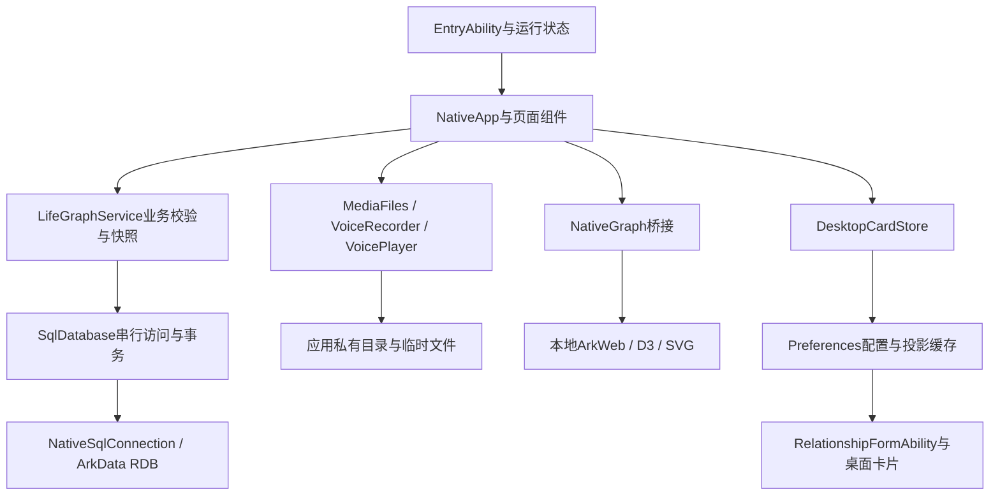
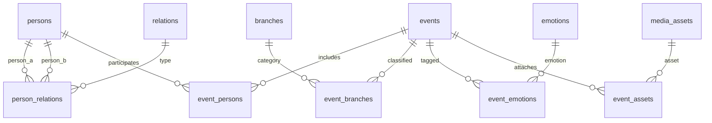
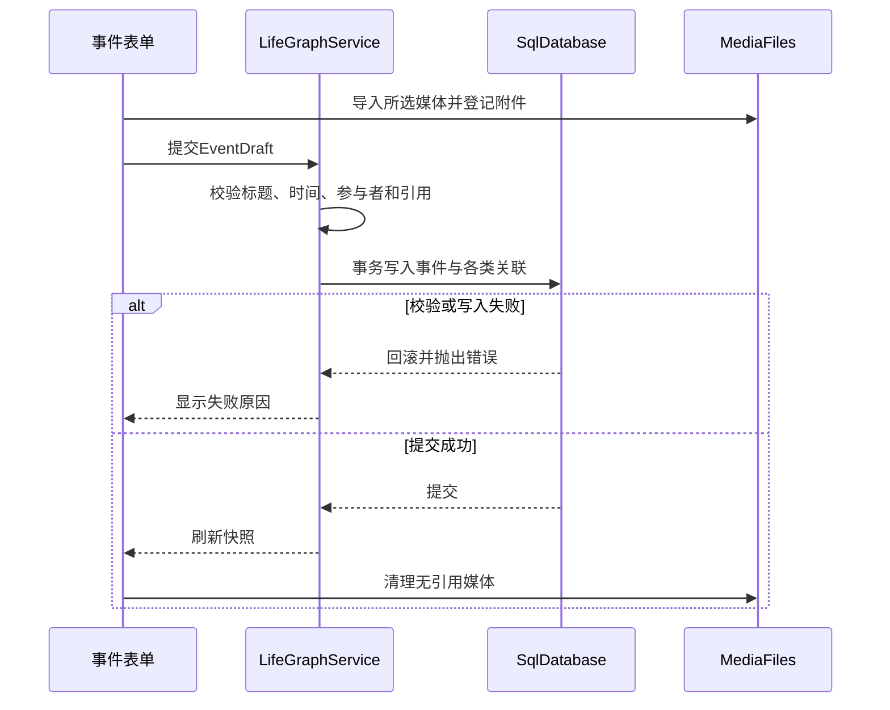

# 系统架构与数据设计

版本：1.0.0　｜　代码基线：`0cba655`

## 1. 运行结构

应用以ArkTS/ArkUI实现原生页面、表单和导航，使用ArkData RDB保存结构化记录，应用私有目录保存媒体。图谱在ArkWeb中加载随包分发的D3.js 7.9.0与SVG页面，原生层负责业务数据、缩略图和交互桥接。桌面卡片使用FormKit及ArkTS组件。

数据模型和业务校验与页面分别组织，原生文件、数据库接口可在宿主测试中替换。`NativeApp.ets`同时承担页面状态和操作编排，尚未形成完全独立的ViewModel层，因此不将系统描述为彻底解耦的MVVM实现。

## 2. 主要模块

| 模块 | 职责 |
| --- | --- |
| `application/AppServices.ets` | 单实例服务初始化，合并并发打开请求，协调关闭 |
| `features/LifeGraphService.ets` | 初始化、人物与事件写入、分类管理、快照及恢复校验 |
| `data/SqlDatabase.ets` | 通过Promise队列串行访问，封装提交与回滚 |
| `data/NativeSqlConnection.ets` | 连接`lifegraph.db`，释放查询结果集，使用原生事务 |
| `features/GraphData.ets` | 按图谱模式、中心和筛选条件投影节点与连线 |
| `components/NativeGraph.ets` | 载荷去重、主题与生命周期、Web桥和缩放按钮 |
| `features/EventQuery.ets` | 关键词、分支、人物筛选及时间分组排序 |
| `data/MediaFiles.ets` | 系统选择器、附件导入、缩略图及文件清理 |
| `data/NativeBackup.ets`、`StoredZip.ets` | 备份流式读写、校验、预览及文件往返 |
| `features/DesktopCard.ets`、`data/DesktopCardStore.ets` | 卡片数据投影、共享配置、缓存和系统更新 |

## 3. 数据结构

数据库模式版本为1。`Schema.ets`定义11张业务表，初始化另建`app_config`，共12张备份表。时间使用毫秒时间戳，主键使用随机UUID。

| 表 | 内容与约束 |
| --- | --- |
| `persons` | 名称、描述、头像引用、创建/更新时间、隐藏标记；名称不唯一 |
| `relations` | 关系类型；活跃名称唯一 |
| `person_relations` | 人物对、类型及强度；两端不同，按ID顺序存储，活跃三元组唯一 |
| `events` | 标题、正文、发生时间、地点文字、颜色及历史字段 |
| `event_persons` | 事件参与人；活跃事件—人物组合唯一 |
| `branches`、`event_branches` | 生活分支及事件的多对多关联 |
| `emotions`、`event_emotions` | 情绪标签及事件的多对多关联 |
| `media_assets` | 沙箱文件名、类型、MIME及删除标记 |
| `event_assets` | 事件媒体引用、封面/附件/语音角色与排序 |
| `app_config` | 个人资料、外观及历史兼容配置 |

人物头像是`persons.avatar_asset_id`到媒体表的逻辑引用，模式没有为它建立外键，保存和恢复时由业务层额外检查。模式中`visibility`及video等枚举为历史保留字段，不表示当前具有公开分享或视频功能。

## 4. 写入与文件一致性

数据库事务不能同时回滚文件系统，因此附件先登记，再通过引用判断清理。取消编辑只清理无有效引用的新增媒体；替换头像或删除事件后，仍被其他对象引用的文件继续保留。恢复失败清理本次复制文件，保留原数据库；已提交后的关闭或清理异常与业务恢复失败分别处理。

## 5. 图谱与卡片的数据边界

图谱接收所需节点、边和编码后的本地缩略图，不向网页暴露任意文件访问。Web使用`blockNetwork(true)`、`fileAccess(false)`、`MixedMode.None`；为支持内嵌图片保留`onlineImageAccess(true)`与`imageAccess(true)`。应用清单不声明INTERNET。

普通图谱返回采用可见性恢复，避免重新加载导致布局和缩放重置；Web渲染采用`ASYNC_RENDER`。图谱缩放范围、裁剪和筛选口径见功能规格。卡片缓存包括短标签、连线和统计摘要，紧凑页面不渲染事件明细，默认隐藏称呼；卡片缓存与业务数据库分开维护。

## 6. 存储与访问说明

RDB安全级别配置为S1，不等于额外启用了应用层数据库加密。媒体位于应用私有目录，ZIP导出没有密码加密。系统备份恢复扩展已启用，是否由系统备份、云空间或换机处理取决于系统设置，与应用自有云同步不同。

当前存在历史助手相关纯逻辑、配置和兼容数据结构，但正式界面没有助手入口，也没有原生HTTP客户端。备份导出按表保存`app_config`，不能据此承诺过滤了所有历史配置内容。

## 7. 设计约束

业务快照包含本机人物、关系、事件及媒体，尚无大规模数据下的分段加载和性能测量结论。图谱与原生组件之间存在主题、生命周期及渲染路径的耦合，相关回归应结合设备检查。桌面卡片各实例共用配置，不支持按卡片分别设置。平台检测记录见[上架与平台检测结果](../04-迭代与质量保障/上架与平台检测结果.md)。
