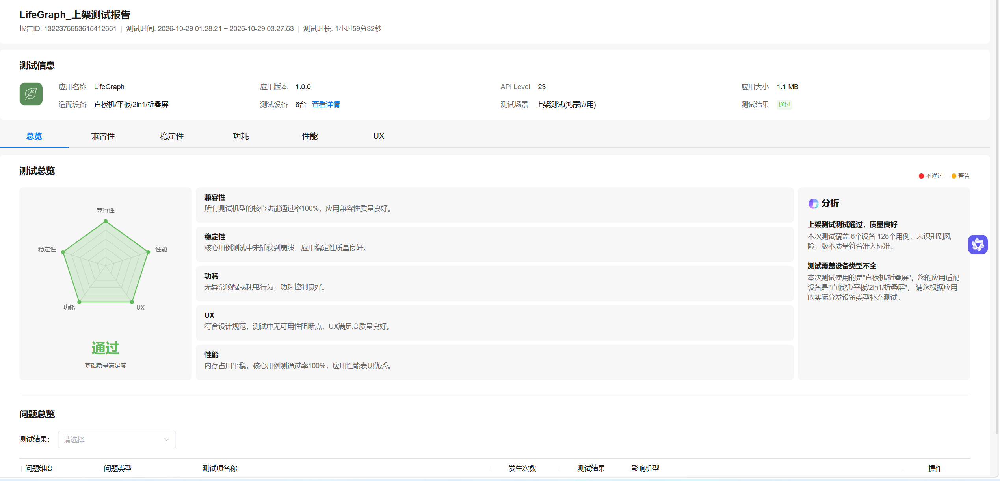
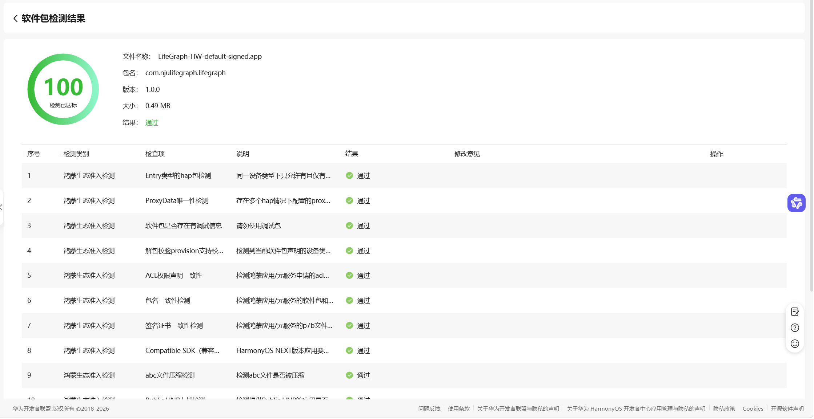

# 上架与平台检测结果

应用：LifeGraph　｜　版本：1.0.0　｜　包名：`com.njulifegraph.lifegraph`

LifeGraph 1.0.0已正式上架华为应用市场。发布验证材料包括华为平台的上架测试结果和软件包检测结果，原始截图如下。

## 1. 上架测试

| 项目 | 平台记录 |
| --- | --- |
| 测试场景 | 上架测试（鸿蒙应用） |
| 测试时间 | 2026-10-29 01:28:21—03:27:53 |
| 测试时长 | 1小时59分32秒 |
| 应用版本 / API Level | 1.0.0 / 23 |
| 设备与用例 | 6台设备、128个用例 |
| 测试结果 | 通过，平台总评为质量良好 |

平台报告列示：测试机型核心功能通过率100%；核心用例未捕获崩溃；未发现异常唤醒或耗电行为；UX检查未发现可用性阻断点；性能项记录内存占用平稳、核心用例通过率100%。

图1　LifeGraph 1.0.0上架测试总览，包含兼容性、稳定性、功耗、UX及性能结果。

本次设备类型覆盖直板机和折叠屏。平台同时提示未覆盖全部声明适配类型，平板及2in1未纳入该次设备覆盖。

## 2. 软件包检测

| 项目 | 平台记录 |
| --- | --- |
| 文件名 | `LifeGraph-HW-default-signed.app` |
| 包名 | `com.njulifegraph.lifegraph` |
| 版本 | 1.0.0 |
| 软件包大小 | 0.49 MB |
| 检测得分 | 100，检测已达标 |
| 检测结果 | 通过 |

Entry类型HAP、ProxyData唯一性、调试信息、provision支持校验、ACL权限声明一致性、包名一致性、签名证书一致性、Compatible SDK及abc文件压缩等各类测试结果均为通过。

图2　LifeGraph 1.0.0软件包检测结果，显示正式包名、版本、检测得分及部分检查项。

开发侧回归及具体缺陷的定位证据保留在[缺陷记录](bugs.md)、各专题案例和工程测试脚本中，不再单独编制重复的本地最终测试报告。
