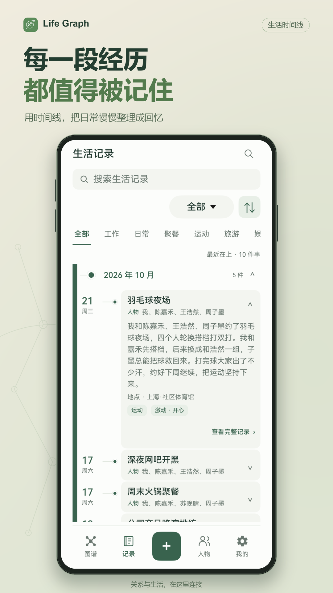
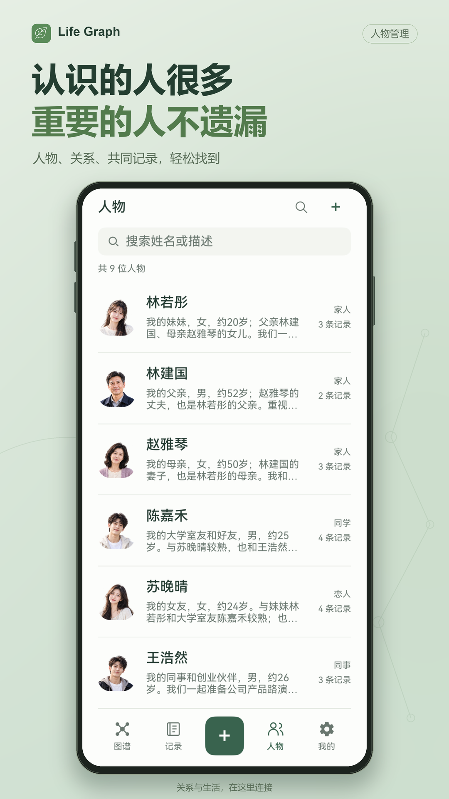
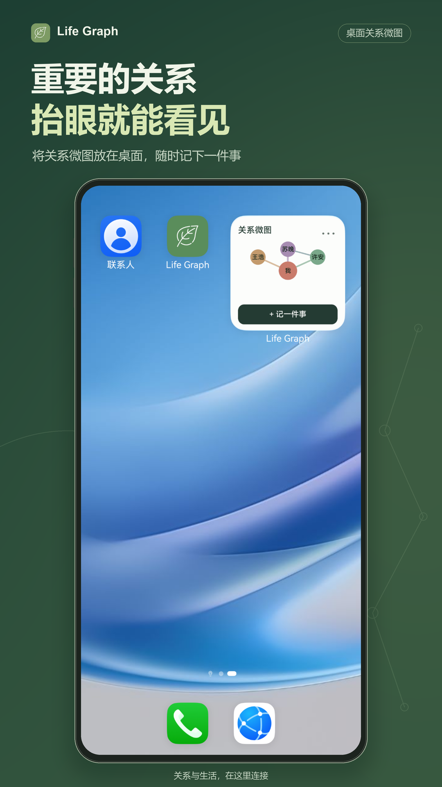

# Life Graph · 生活脉络

把重要的人与事，留在生活的脉络里。

**Life Graph** 是一款面向 HarmonyOS 的生活记忆与关系图谱应用。它以人物、事件和它们之间的联系组织记录，让一次聚餐、一段旅行或一位老朋友，都能从时间和关系两个方向重新找到。

应用支持文字、照片和音频记录，业务数据保存在本机，无需注册账号。鸿蒙版以 ArkTS、ArkUI 和 RDB 重建主要功能，并提供桌面关系微图及本地备份恢复。

**当前版本：1.0.0，已正式上架华为应用市场。**

## 主要功能

- **人物与关系**：保存称呼、头像和备注，记录任意两人之间的关系类型及手动强度。
- **生活事件**：将文字、照片和语音关联到多位参与者，补充时间、地点、生活分支和情绪。
- **关系与生活图谱**：拖动、缩放和筛选节点，从人物联系进入相关记录。
- **时间线与搜索**：按月回顾经历，通过人物、关键词和生活分支找回事件。
- **桌面关系微图**：使用2×2卡片展示选定人物与连线，快速进入人物详情或新建记录。
- **个人空间与备份**：调整主题和明暗模式，管理分类，导出或恢复本机ZIP备份。

## 应用预览

| 生活时间线 | 人物管理 | 桌面关系微图 |
| :---: | :---: | :---: |
|  |  |  |

[查看全部11张应用宣传图](LifeGraph-HW/docs/assets/screenshots/)

## 技术实现

| 部分 | 实现 |
| --- | --- |
| 原生界面与交互 | ArkTS、ArkUI |
| 本机结构化数据 | ArkData RDB |
| 图谱绘制 | ArkWeb加载随包分发的D3.js与SVG |
| 图片与音频 | 系统选择器、原生录音与播放、应用私有文件目录 |
| 桌面卡片 | FormKit、2×2关系微图 |
| 数据备份 | 本地ZIP导出、校验与恢复 |

后续版本可能提供登录、会员、应用自有云同步或AI助手等功能。

## 运行与文档

在 DevEco Studio 中打开 [`LifeGraph-HW`](LifeGraph-HW/README.md)，完成依赖Sync，选择匹配SDK的模拟器或设备，运行`entry`模块。

| 入口 | 内容 |
| --- | --- |
| [项目文档](LifeGraph-HW/docs/README.md) | 需求、用户研究、规格、架构、迭代与质量记录 |
| [使用手册](LifeGraph-HW/docs/05-部署与使用/使用手册.md) | 人物、记事、图谱、搜索、桌面卡片与备份操作 |
| [构建与部署](LifeGraph-HW/docs/05-部署与使用/构建与部署.md) | 环境、构建、签名与安装说明 |
| [上架与平台检测结果](LifeGraph-HW/docs/04-迭代与质量保障/上架与平台检测结果.md) | 华为平台上架测试和软件包检测截图 |

鸿蒙工程位于`LifeGraph-HW/`；正式项目文档位于`LifeGraph-HW/docs/`。项目沿用了原Android/Expo版本的人物与事件记录概念，原始研究资料保留在仓库资料区，鸿蒙功能及技术实现以当前工程为准。
